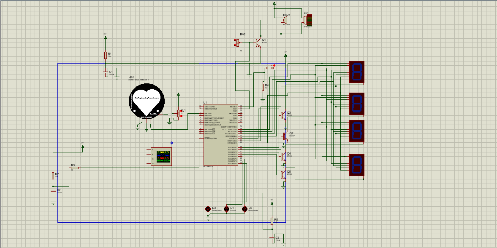

# Embedded Heartbeat Monitor

An embedded heartbeat monitoring system implemented using the PIC16F877A microcontroller.

## Overview

This project focuses on developing an embedded system for heartbeat monitoring using the PIC16F877A microcontroller.

The system acquires heartbeat signals through the Analog-to-Digital Converter (ADC), processes the readings, and calculates the heart rate.

The project combines C and Assembly programming with circuit design and simulation using Proteus.

## Hardware & Software

- **Microcontroller:** PIC16F877A
- **Programming Languages:** C, Assembly
- **Simulation Software:** Proteus
- **Peripheral:** Analog-to-Digital Converter (ADC)

## Circuit Design

The circuit was designed and simulated using Proteus.

## Key Features

- Heartbeat signal acquisition using ADC.
- Heart rate calculation.
- PIC16F877A-based embedded implementation.
- C and Assembly programming.

## Author

**Nicola Qaisyah**

Computer Engineering Student  
University of Jordan
